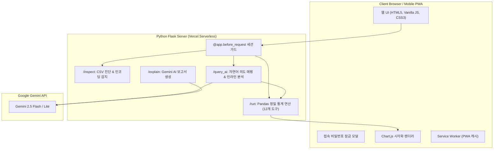

# 📊 AI Data Insight Builder

> **공식 통계 CSV 정밀 진단부터 정밀 Pandas 계산과 Gemini AI 해석까지 원스톱으로 제공하는 지능형 데이터 분석 웹 플랫폼**

[](https://www.python.org/)
[](https://flask.palletsprojects.com/)
[](https://aistudio.google.com/)
[](https://www.chartjs.org/)
[](https://web.dev/progressive-web-apps/)
[](https://vercel.com/)

---

## 🌐 라이브 데모 (Live Demo)

- **웹 서비스 주소**: [https://data-insight-builder.vercel.app](https://data-insight-builder.vercel.app) *(본인의 Vercel 배포 주소)*
- **초기 접속 비밀번호**: `1234`

---

## ✨ 핵심 기능 소개 (Key Features)

### 1. 🔍 CSV 파일 자동 감지 및 무결점 정밀 진단
- **스마트 인코딩 판별**: `UTF-8`, `CP949(EUC-KR)`, `Latin-1`, `UTF-8-SIG(BOM)` 순차 시도로 한글 깨짐 원천 차단
- **메타데이터 자동 추출**: 총 행/열 수, 결측치 비율, 연속 연도 시계열 컬럼, 수치형/문자형 컬럼 자동 분리
- **합계/평균 중복 행 감지**: 'Total', 'World', '소계', '합계' 등 통계를 왜곡하는 집계 행을 감지하여 분석 시 선택적 제외 지원

### 2. ⚡ 정밀 Pandas 연산과 Gemini AI 해석의 완벽한 분리
> **"계산(Calculation)은 Pandas가 100% 정밀하게, 해석(Interpretation)은 Gemini AI가 알기 쉽게!"**
- LLM의 환각(Hallucination)에 의한 수치 계산 오류를 원천 차단하는 안전한 아키텍처
- 12가지 통계 분석 도구(순위, 시계열, 변화율, 비중, 이상치 등)를 파이썬 Pandas 엔진으로 정확하게 산출

### 3. 💬 자연어 자유 질의 & 인라인 맞춤 시각화 (AI Assistant)
- **틀 없는 자연어 질문**: *"대한민국 바로 아래 순위 알려줘"*, *"상위 10개국 하위 10개국 순위 보여줘"* 등 자유롭게 질문
- **질문창 바로 아래 차트 즉시 생성**: 질문 의도에 최적화된 Chart.js 시각화 차트와 수치 표를 질문 박스 바로 아래 인라인에 자동 렌더링
- **한국 강조 하이라이트**: 질의어에 맞추어 관심 대상(한국 등)을 독자적인 색상으로 강조 표시

### 4. 🔒 앱 접속 비밀번호 잠금 보안
- 모던한 Glassmorphism 오버레이 비밀번호 인증 시스템
- 세션 기반 접근 제어로 비인가 사용자의 데이터 분석 API 호출 원천 차단
- 상단 헤더의 `🔒 잠금` 버튼으로 언제든지 앱 화면 잠금 가능

### 5. 📱 PWA 지원 및 완벽한 모바일 최적화
- **홈 화면 추가(PWA)**: 스마트폰(Android, iOS) 및 PC에서 앱스토어 없이 독립형 네이티브 앱으로 설치/다운로드 가능
- **반응형 모바일 UI**: 작은 스마트폰 화면에서도 차트, 표 스크롤, 터치 타깃 44px 이상 확장으로 쾌적한 조작감 제공
- **서비스 워커 캐싱**: 오프라인 및 고속 구동을 위한 정적 앱 셸 캐싱 지원

---

## 🛠️ 지원하는 12가지 통계 분석 도구 (Tool Catalog)

| 번호 | 분석 도구명 | 핵심 내용 | 차트 유형 |
|:---:|:---|:---|:---|
| 01 | **상위·하위 N 순위 분석** (`top_bottom_n`) | 기준 시점 최고/최저 N개 항목 순위 비교 | 수평 막대 차트 |
| 02 | **시계열 추이 분석** (`trend_line`) | 관심 대상들의 연도별 시계열 변화 흐름 | 다중 꺾은선 차트 |
| 03 | **단일 항목 vs 전체 비교** (`compare_one_vs_all`) | 특정 항목과 전체 평균/중앙값/최고값 대조 | 비교 막대 차트 |
| 04 | **두 시점 간 변화량·성장률** (`change_rate`) | 과거 대비 증가폭(%p) 및 성장률(%) 분석 | 수평 변화 막대 차트 |
| 05 | **통계 분포 지표 요약** (`distribution_stats`) | 평균, 표준편차, 왜도, 사분위수 종합 요약 | 박스플롯 / 지표 카드 |
| 06 | **다변량 상관관계 분석** (`correlation_analysis`) | 수치형 지표 간의 피어슨 상관계수 산출 | 매트릭스 그리드 |
| 07 | **범주별 그룹 집계** (`group_aggregation`) | 특정 범주 기준 평균/합계 집계 | 그룹 막대 차트 |
| 08 | **이동평균 추세 평활화** (`moving_average`) | 단기 변동 제거를 통한 중장기 트렌드 파악 | 이동평균 추세선 차트 |
| 09 | **이상치(Outlier) 탐지** (`anomaly_outliers`) | IQR 1.5배 기준 통계적 특이값 및 이상 패턴 탐지 | 산점도 / 경고 배너 |
| 10 | **전체 대비 점유율·비중** (`share_percentage`) | 전체 총합 중 주요 항목이 차지하는 퍼센트 비중 | 도넛(Donut) 차트 |
| 11 | **최대-최소 격차 범위** (`min_max_range`) | 연도별 항목 간 수치 격차(Spread) 추이 | 범위 밴드 차트 |
| 12 | **기준점 환산 상대 지수** (`ratio_index`) | 특정 시점(예: 100) 기준 상대 성장 지수화 | 상대 지수 꺾은선 |

---

## 🏗️ 시스템 아키텍처 (Architecture)



---

## 🚀 로컬 실행 방법 (Getting Started)

### 1. 저장소 복제 (Clone)
```bash
git clone https://github.com/parkjaehun123/data-insight-builder.git
cd data-insight-builder
```

### 2. 가상환경 생성 및 패키지 설치
```bash
python -m venv .venv
# Windows
.\.venv\Scripts\activate
# Mac / Linux
source .venv/bin/activate

pip install -r requirements.txt
```

### 3. 환경 변수 설정 (`.env`)
프로젝트 루트에 `.env` 파일을 생성하고 아래 내용을 입력합니다:
```env
# Google Gemini API Key (https://aistudio.google.com/ 에서 무료 발급)
GEMINI_API_KEY=your_gemini_api_key_here
GEMINI_MODEL=gemini-flash-latest

# Flask 서버 설정
FLASK_DEBUG=true
MAX_UPLOAD_MB=10

# 앱 접속 비밀번호 및 세션 암호화 키
APP_PASSWORD=1234
SECRET_KEY=your_secret_session_key_here
```

### 4. 서버 실행
```bash
python app.py
```
브라우저에서 `http://127.0.0.1:5000`으로 접속하여 비밀번호 `1234`를 입력하고 사용합니다.

---

## ☁️ Vercel 배포 가이드 (Vercel Deployment)

1. **GitHub 저장소 연결**: Vercel 대시보드에서 `parkjaehun123/data-insight-builder` 저장소를 Import합니다.
2. **환경 변수 등록**: Vercel 프로젝트의 **Settings → Environment Variables**에서 아래 항목을 등록합니다:
   - `GEMINI_API_KEY`: 본인의 Gemini API Key
   - `APP_PASSWORD`: 원하는 접속 비밀번호 (예: `1234`)
   - `SECRET_KEY`: 임의의 긴 보안 문자열
3. **배포(Deploy)**: 코드가 푸시될 때마다 Vercel에서 자동으로 서버리스 앱이 빌드되어 배포됩니다.

---

## 📂 프로젝트 디렉토리 구조 (Directory Structure)

```text
data-insight-builder/
├── app.py                 # Flask 메인 애플리케이션 및 라우트 컨트롤러
├── tools.py               # 12가지 Pandas 통계 분석 도구 연산 모듈
├── vercel.json            # Vercel Python Serverless 배포 구성 파일
├── requirements.txt       # 파이썬 의존성 패키지 목록
├── .env.example           # 환경 변수 템플릿
├── templates/
│   └── index.html         # 반응형 메인 웹 애플리케이션 템플릿
└── static/
    ├── app.js             # 바닐라 JS 프론트엔드 비즈니스 로직
    ├── style.css          # 모바일 반응형 및 PWA 모던 CSS 스타일
    ├── manifest.json      # PWA 웹 앱 매니페스트 설정
    ├── sw.js              # PWA 오프라인 캐싱 서비스 워커
    └── icons/             # 192x192, 512x512, SVG 고해상도 앱 아이콘
```

---

## 📄 라이선스 (License)

This project is licensed under the MIT License - see the LICENSE file for details.
